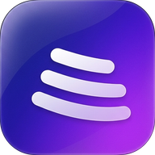
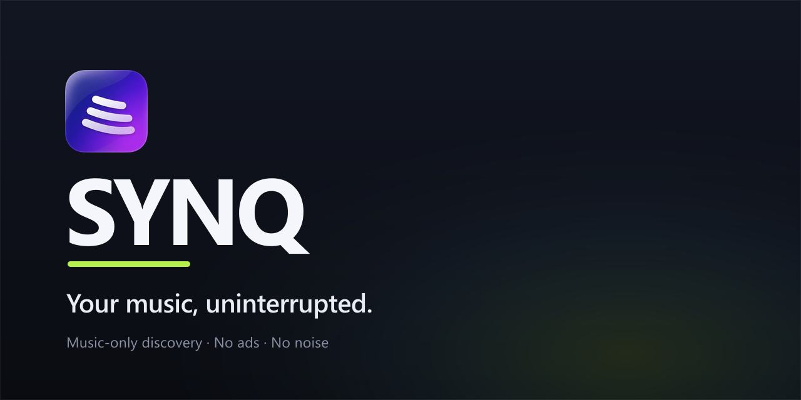

<div align="center">

<br/>
<br/>



# SYNQ

### Your music, uninterrupted.

<br/>

[](package.json)
[](#download)
[](#known-limitations)
[](#licence)

<br/>

[**Download**](#download) · [**Features**](#features) · [**Screenshots**](#screenshots) · [**Install**](#install) · [**Tech stack**](#tech-stack) · [**Development**](#development) · [**Support**](#support)

</div>

> [!IMPORTANT]
> SYNQ is an independent, community-driven music player. It is **not** affiliated with, endorsed by, or connected to YouTube, Google, Spotify, Apple, SoundCloud, Deezer, TIDAL or Bandcamp. It hosts no music: playback resolves through third-party services, and you are responsible for how you use it.

---

<div align="center">



<h1><a id="features"></a>Features</h1>

<table>
  <tr>
    <td width="50%" valign="top">

#### Playback

- **Two audio decks, not one.** A real crossfade needs both songs audible at once, so the player owns two `<audio>` elements plus their Web Audio graphs.
- **Crossfade, 0–10 s.** Off by default — a crossfade is an opinionated listening choice. Every transition decision (crossfade, gapless, hard cut) comes from one pure module, `src/lib/transition.ts`.
- **Gapless playback.** The next track is preloaded and buffered before the boundary, so albums and DJ mixes run without silence.
- **Repeat-one and A-B loop are honoured**, never interrupted by a fade.
- **Sleep timer, volume normalization, pitch, reverb and distortion**, driven by the same playback state.
- **10-band graphic EQ** (32 Hz – 16 kHz, ±12 dB) plus bass/treble shelves and balance — each on its own filter nodes, so a preset can never silently reset your manual curve.
- **Genuine background playback.** One module owns every OS-facing "now playing" surface: the Media Session API on the web, and a native media session plus a `mediaPlayback` foreground service on Android.

#### Discovery

- **Search that explains itself.** A pure relevance engine (`src/lib/searchRelevance.ts`) compares a query against each result's own title, artist and album, so an approximate match cannot outrank an exact one.
- **Real artist catalogues.** Artist pages read YouTube Music's `browse` endpoint: the full release grid (albums, singles, EPs, live, compilations), grouped by type, each release opening its own page and complete tracklist.
- **Home shelves** built from history, likes and remote pools, with duplicate suppression across reissues and deluxe editions.
- **Mixes, Discover and "not interested"**, plus **smart playlists** — saved rule sets recomputed on every open.
- **SoundCloud as a first-class source.** Search returns uploads, remixes and indie releases YouTube does not surface. Playback requires a progressive stream; HLS-only tracks are reported as unavailable rather than faked.

    </td>
    <td width="50%" valign="top">

#### Library

- **Likes, playlists, history, recent and listening stats**, synced to your account through Convex.
- **Cross-account playlist sharing.** View-only grants: recipients can open, play and shelf a shared playlist but can never edit, delete or re-share it. Recipient search returns names and avatars only, never emails.
- **Import** from YouTube, YouTube Music, Spotify, Apple Music, SoundCloud, Deezer, TIDAL and Bandcamp, with a per-service capability table and a repair pass for entries a provider no longer resolves.
- **Offline downloads** for Creative Commons releases the artist actually published for download. The backend re-checks permission on every ranged request, and the bytes land in OPFS with a licence record.
- **Recap** — periodic listening summaries shaped from existing play events, with no extra data collection.

#### Experience

- **Lyrics** with a live visualiser driven by the analyser node.
- **Themes and scenes.** 28 accent scenes, Dark / Light / AMOLED, live wallpapers, adjustable glass transparency, and an animations level.
- **Dynamic-island player** on phones, a full-screen player with video, and a queue panel that survives navigation.
- **Web / PWA, Windows desktop and Android**, each with its own shell rather than a wrapped web page.

</td>
  </tr>
</table>

</div>

---

<div align="center">

<h1><a id="screenshots"></a>Screenshots</h1>

SYNQ is best judged running, not photographed — open the web app and listen:

**[synqmusic.freebuff.app](https://synqmusic.freebuff.app)**

Interface screenshots are captured from the running app at each release; none are checked into the repository yet.

</div>

---

<div align="center">

<h1><a id="download"></a>Download</h1>

<a href="https://synqmusic.freebuff.app" target="_blank" rel="noopener noreferrer"></a>

</div>

**No GitHub Releases have been published yet**, so there are no installer or APK downloads to link. The table below is the honest status of each platform.

| Platform | Status | How to get it |
| --- | --- | --- |
| **Web / PWA** | **Available now** | [synqmusic.freebuff.app](https://synqmusic.freebuff.app) — installable from the browser |
| **Windows 10 / 11** | Builds locally, no public installer yet | `npm run desktop:installer` → `desktop-dist/SYNQ-Setup-1.0.0.exe` |
| **Android 8.0+** | Builds locally, no public APK yet | `npm run android:apk` → `android/app/build/outputs/apk/` |
| **iOS** | Not built | — |
| **Linux / macOS** | Not built | The Electron shell targets Windows only |

> [!NOTE]
> Once releases are published, this section gets the same download badges as the web app, pointing at the Release assets. Nothing here pretends a build exists before it does.

---

<div align="center">

<h1><a id="install"></a>Install</h1>

</div>

### Web / PWA

1. Open **[synqmusic.freebuff.app](https://synqmusic.freebuff.app)** in Chrome, Edge or Safari.
2. Optionally install it: **Chrome/Edge** → install icon in the address bar; **Safari (macOS)** → File → Add to Dock; **Android** → ⋮ → *Add to Home screen*.
3. Sign in with an email one-time code, or continue as a guest to browse.

**Requirements:** a modern browser with Web Audio and Media Session support. Playback needs network access; downloaded Creative Commons tracks play offline.

### Windows

1. Build the installer from source (see [Development](#development)):
   ```bash
   npm run build:icon          # generates build/icon.ico from public/logo.png
   npm run desktop:installer   # NSIS installer in desktop-dist/
   ```
2. Run `desktop-dist/SYNQ-Setup-1.0.0.exe`. Windows SmartScreen will warn about an unsigned build — **More info → Run anyway** is expected for a self-signed installer.
3. The desktop shell serves `dist/` from `app://synq/`, so router paths and deep links keep working. It needs `dist/` to exist: run `npm run build` first.

### Android

1. Install **JDK 21** and the **Android SDK**, then point the project at the SDK in `android/local.properties` (`sdk.dir=...`).
2. Build:
   ```bash
   npm run android:apk        # debug APK
   npm run android:release    # signed release (needs android/keystore.properties)
   ```
3. Install the APK over USB (`adb install`) or by copying it to the device. Enable **Install unknown apps** for the app you open it with.
4. Release builds need your own keystore — start from `android/keystore.properties.example`. It is not in the repository, on purpose.

### Troubleshooting

| Symptom | Cause | Fix |
| --- | --- | --- |
| Blank page after `npm run desktop:start` | No `dist/` build | `npm run build` first |
| "Nothing but the shell" / no library | No Convex deployment | Run `npx convex dev` and set `VITE_CONVEX_URL` |
| Track spins then reports a failure | Provider refused the stream | Pick another result — the UI names the layer that failed |
| Android build: `SDK location not found` | Missing `local.properties` | Add `sdk.dir` pointing at your SDK |
| `gradlew` permission denied on macOS/Linux | Archive lost the exec bit | `chmod +x android/gradlew` |
| SmartScreen / Play Protect warning | Unsigned local build | Expected — sign your own release |

---

<div align="center">

<h1><a id="tech-stack"></a>Tech stack</h1>

</div>

| Layer | Choice |
| --- | --- |
| UI | React 19, React Router 7, Tailwind CSS v4, shadcn/ui on Radix primitives, Lucide icons, Motion |
| Build | Vite 7, TypeScript 5.9, ESLint 9, Prettier |
| State | Zustand stores (`src/store`) plus pure decision modules in `src/lib` |
| Backend | Convex — database, queries/mutations/actions, HTTP routes, scheduled jobs |
| Auth | Convex Auth — email code, guest, optional Google/GitHub OAuth |
| Audio | Web Audio API over two `<audio>` decks, biquad EQ chain, OPFS for offline files |
| Desktop | Electron 33 + electron-builder (NSIS) |
| Android | Capacitor 8 |
| Tests | `bun test` (Vitest-compatible suites) |

---

<div align="center">

<h1><a id="development"></a>Development</h1>

</div>

**Requirements:** Node.js 20+ and npm. Bun is optional but is the fastest way to run the test suite.

```bash
git clone https://github.com/raisulkhan23/SYNQ-Music-Player.git
cd SYNQ-Music-Player
npm install
```

### 1. Point the app at a Convex deployment

The backend is Convex: database, auth, catalogue actions and HTTP routes all live there. Nothing but the shell runs without it.

```bash
npx convex dev
```

That creates (or links) a deployment, writes `VITE_CONVEX_URL` into `.env.local`, generates `src/convex/_generated`, and pushes the schema and functions.

### 2. Configure the backend

Copy `.env.example` to `.env.local` for frontend values, then set server-only values on the deployment:

```bash
npx @convex-dev/auth          # writes JWT_PRIVATE_KEY and JWKS
npx convex env set JAMENDO_CLIENT_ID your-key
npx convex env list           # confirm what the deployment can see
```

Every variable is documented in `.env.example`. The app degrades honestly when one is missing — no Jamendo key means no downloads, no lyrics provider key means LRCLIB only — and only `VITE_CONVEX_URL` is required to boot.

### 3. Run it

```bash
npm run dev          # http://localhost:5173
npm run build        # tsc -b && vite build
npm run preview      # serve the production build
npm run lint
```

### 4. Test it

```bash
npm run build:icon   # one suite checks the generated installer icon
bun test             # the full suite
```

### Project layout

```
src/
  pages/        route-level screens (Home, Search, Artist, Album, Playlists, …)
  components/   UI by domain: player, search, library, settings, landing, admin
  store/        Zustand stores — the player store is the only owner of audio state
  lib/          pure decision logic (transitions, relevance, imports, downloads)
  convex/       schema, queries, mutations, actions, HTTP routes, crons
electron/       desktop main process, tray, deep links, download relay
android/        Capacitor Android project
tests/          one file per behaviour, named for the behaviour
scripts/        asset generation and verification harnesses
assets/         README artwork (logo, banner)
```

The split is deliberate: everything that can be decided without a browser lives in `src/lib` and is unit tested, and the React layer subscribes to those decisions instead of re-implementing them.

---

<div align="center">

<h1><a id="known-limitations"></a>Known limitations</h1>

</div>

- **The catalogue is not licensed.** Playback resolves streams from third-party services. That is how SYNQ works and also why it cannot be redistributed as a commercial product as-is.
- **Playback depends on third parties.** YouTube bot-checks from datacenter IPs and provider outages can make individual tracks unplayable. The UI reports which layer failed rather than pretending the track is loading.
- **SoundCloud playback is currently blocked for most tracks.** Search works, but SoundCloud now serves HLS and the resolver only accepts progressive MP3, so HLS-only tracks are refused with an explicit message. Supporting them needs an HLS player in the client.
- **Transitions are crossfade, gapless and cut.** There is no beat-matched or tempo-stretched AutoMix.
- **Account features need Convex.** With no deployment you get the shell and guest browsing, not a library.
- **Platform coverage is uneven.** Desktop is Windows-only and was developed on Windows; Android needs a local SDK; iOS has not been built.
- **No CI is configured.** The build, type check and test suite are run locally.

---

<div align="center">

<h1><a id="support"></a>Support</h1>

</div>

- **Bug reports and feature requests:** [open an issue](https://github.com/raisulkhan23/SYNQ-Music-Player/issues).
- **Security or credential concerns:** please report privately rather than in a public issue.
- **Pull requests** are welcome for the documented limitations above; keep the pure decision modules in `src/lib` unit tested.

---

<div align="center">

<h1><a id="licence"></a>Licence</h1>

</div>

No licence has been granted for this code. It is published so the work can be read and studied; that is not the same as permission to reuse, redistribute or ship it. If you want to use part of it, ask first.

Third-party libraries keep their own licences, and every provider integration is governed by that provider's terms. Nothing here grants rights to anyone's catalogue.

---

<div align="center">

<h1><a id="history"></a>A note on the history</h1>

This repository is a curated public release. It starts from a fresh history that contains only reviewed commits — no development history, no credentials, no machine-specific files. See [docs/RELEASING.md](docs/RELEASING.md) for how updates are published.

</div>
