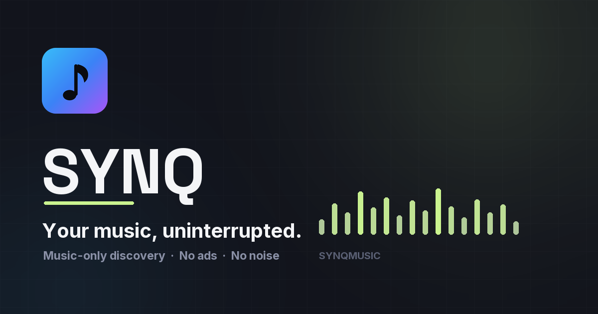

# SYNQ

**Your music, uninterrupted.**

SYNQ is a music player for the web, Windows and Android. It plays from YouTube
Music's catalogue, keeps the queue moving with beat-aligned AutoMix transitions,
and gives you a real library — playlists, likes, history, smart playlists,
lyrics, offline downloads and a listening recap — without ads interrupting the
music.



---

## What it does

### Playback

- **Two audio decks, not one.** A crossfade needs the outgoing and incoming song
  audible at the same time, so the player owns two `<audio>` elements plus their
  Web Audio graphs. Every transition decision (crossfade, gapless, hard cut,
  repeat-one, A-B loop) is made by a pure module — `src/lib/transition.ts` — that
  the player asks rather than re-derives.
- **AutoMix.** When two tracks have been analysed, the boundary becomes a
  beat-aligned blend: the outgoing deck is nudged onto the beat grid, the
  incoming one starts at the first beat that works, and the fade length is
  chosen from what the tracks actually contain. Analysis runs in a worker
  (`src/lib/analysisScheduler.ts`), so it never blocks the UI.
- **A resolution chain that survives provider failure.** Playback asks the
  Convex resolver first, falls back to browser-side Piped resolution from the
  listener's own IP, and finally to a server-side audio proxy. Each layer reports
  why it failed, so a broken source is a message rather than a spinner.
- **Genuine background playback.** One module
  (`src/lib/mediaSession.ts`) owns every OS-facing "now playing" surface: the
  Media Session API on the web and a native media session plus `mediaPlayback`
  foreground service in the Android build.
- **Sleep timer, volume, seek, gapless queue handoff, intro trim** — all decided
  from the same playback state, so there is one answer per question.

### Discovery

- **Search that explains itself.** A pure relevance engine
  (`src/lib/searchRelevance.ts`) ranks results by comparing the query to each
  result's own title, artist and album, so an approximate match cannot outrank an
  exact one. The same function runs on the backend and in the UI.
- **Real artist catalogues.** Artist pages read YouTube Music's `browse`
  endpoint: the full release grid (albums, singles, EPs, live, compilations),
  grouped by type, with every release opening its own album page and complete
  tracklist. Identity is credit-based, so `"The Chainsmokers feat. Daya"` is a
  guest appearance rather than one of Daya's releases.
- **Home shelves** built from history, likes and remote pools with duplicate
  suppression across reissues and deluxe editions (`src/lib/homeShelves.ts`).
- **Mixes, Discover, "not interested"**, and **smart playlists** — saved rule
  sets recomputed on every open, over signals the app already has.

### Library

- **Likes, playlists, history, recent, stats** — synced to your account through
  Convex.
- **Cross-account playlist sharing.** View-only grants: recipients can open,
  play and shelf a shared playlist but can never edit, delete or re-share it.
  Recipient search returns names and avatars only, never emails.
- **Import** from YouTube / YouTube Music, Spotify, Apple Music, SoundCloud,
  Deezer, TIDAL and Bandcamp, with a per-service capability table and a repair
  pass for entries the provider no longer resolves.
- **Offline downloads.** Only Creative Commons releases the artist actually
  published for download (Jamendo) are eligible; the backend re-checks
  permission for every ranged request, and the bytes land in OPFS with a licence
  record so a downloaded track plays with the network off.
- **Recap** — periodic listening summaries shaped from `playEvents`, with no
  extra data collection.

### Shells

- **Web / PWA** — service worker, installable manifest, safe-area-aware mobile
  layout.
- **Windows desktop** — Electron, serving `dist/` from `app://synq/` so real
  router paths and deep links keep working; NSIS installer via
  `npm run desktop:installer`.
- **Android** — Capacitor shell with a real launcher activity, native media
  session and foreground service.

---

## Tech stack

| Layer | Choice |
| --- | --- |
| UI | React 19, React Router 7, Tailwind CSS v4, shadcn/ui on Radix primitives, Lucide icons, Framer Motion |
| Build | Vite 7, TypeScript 5.9, ESLint 9, Prettier |
| State | Zustand stores (`src/store`) plus pure decision modules in `src/lib` |
| Backend | Convex (database, queries/mutations/actions, HTTP actions, scheduled jobs) |
| Auth | Convex Auth — email code, guest, optional Google/GitHub OAuth |
| Audio | Web Audio API over two `<audio>` decks, workers for analysis, OPFS for offline files |
| Desktop | Electron 33 + electron-builder |
| Android | Capacitor 8 |
| Tests | Vitest (+ a `bun:test` compatibility shim) over ~125 test files |

---

## Getting started

Requirements: **Node.js 20+** and npm. Bun is optional — the tests were written
for `bun:test` but run under Vitest too.

```bash
git clone https://github.com/raisulkhan23/SYNQ-Music-Player.git
cd SYNQ-Music-Player
npm install
```

### 1. Point the app at a Convex deployment

SYNQ's backend is Convex: database, auth, catalogue actions and HTTP routes all
live there. Nothing but the shell runs without it.

```bash
npx convex dev
```

That command creates (or links) a deployment, writes `VITE_CONVEX_URL` into
`.env.local`, generates `src/convex/_generated`, and pushes the schema and
functions in `src/convex/`.

`src/convex/_generated` is committed so the project typechecks and builds before
you have a deployment; `npx convex dev` rewrites it whenever the schema changes,
and those changes belong in the same commit.

### 2. Configure the backend

Copy `.env.example` to `.env.local` for the frontend values, then set the
server-only values on the deployment:

```bash
npx @convex-dev/auth          # writes JWT_PRIVATE_KEY and JWKS
npx convex env set JAMENDO_CLIENT_ID your-key
npx convex env list           # confirm what the deployment can see
```

Every variable is documented in `.env.example`. The app degrades honestly when
one is missing — no Jamendo key means no downloads, no lyrics provider key means
LRCLIB only, no Gravity key means the ad slot renders nothing — and only
`VITE_CONVEX_URL` is required to boot.

### 3. Run it

```bash
npm run dev          # http://localhost:5173
npm run build        # tsc -b && vite build
npm run preview      # serve the production build
npm run lint
```

### Running the tests

```bash
npm run build:icon   # one suite checks the generated installer icon
npx vitest run       # or, with Bun installed: bun test
```

The suite is written for `bun:test`. `vitest.config.ts` aliases that specifier to
a shim, and most of it runs unchanged — but 22 files use Bun-only APIs
(`mock.module`, `Bun.serve`, `import.meta.dir`) or assign `globalThis.navigator`,
which Node 21+ made read-only. Under Vitest on Node 24 the result is **93 files
passing / 22 failing**, with the failures coming from those APIs rather than from
the code under test. Run them with Bun for a complete pass.

### Desktop and Android

```bash
npm run build:icon            # generates build/icon.ico from public/logo.png
npm run desktop:start         # Electron against the last build
npm run desktop:installer     # NSIS installer in desktop-dist/

npm run android:sync          # build + cap sync android
npm run android:apk           # debug APK (needs a JDK 21 and the Android SDK)
```

The two Android npm scripts call `bun run` internally, so they need Bun on the
PATH — or run the same steps by hand (`npm run build && npx cap sync android`,
then `cd android && ./gradlew assembleDebug`).

The Android build expects `android/local.properties` (SDK path) and, for release
builds, your own `android/keystore.properties` and keystore. Neither is in the
repository; start from `android/keystore.properties.example`.

---

## Project layout

```
src/
  pages/        route-level screens (Home, Search, Artist, Album, Playlists, …)
  components/   UI by domain: player, search, library, settings, landing, admin
  store/        Zustand stores — the player store is the only owner of audio state
  lib/          pure decision logic and adapters (transitions, relevance, imports,
                downloads, lyrics, media session, resolvers)
  convex/       schema, queries, mutations, actions, HTTP routes, crons
electron/       desktop main process, tray, deep links, download relay
android/        Capacitor Android project
tests/          Vitest suites (one file per behaviour, named for the behaviour)
scripts/        asset generation and verification harnesses
```

The split is deliberate: everything that can be decided without a browser lives
in `src/lib` and is unit tested, and the React layer subscribes to those
decisions instead of re-implementing them. When a rule looks duplicated between a
component and a lib module, the lib module is the one that is right.

---

## Known limitations

- **The catalogue is not licensed.** Playback resolves streams from YouTube
  Music through public resolvers. That is how SYNQ works and also why it cannot
  be redistributed as a commercial product as-is. Only Jamendo-licensed releases
  (Creative Commons, download permitted) can be stored offline.
- **Playback depends on third parties.** The resolver chain is resilient, not
  omnipotent: YouTube bot-checks from datacenter IPs, Piped instance churn and
  provider outages can all make individual tracks unplayable. The UI reports
  which layer failed rather than pretending the track is loading.
- **Account features need Convex.** Running with no deployment gives you the
  shell and guest browsing, not a library.
- **Platform coverage is uneven.** Desktop is Windows-only (NSIS target) and was
  developed on Windows; Android is a Capacitor shell that needs a local SDK;
  iOS has not been built.
- **AutoMix quality depends on analysis.** Tracks that never finish analysis
  fall back to the plain crossfade by design.
- **Lint is not clean.** `npm run lint` reports 75 errors that predate this
  release: 37 unused variables, 36 explicit `any`s and 2 hook-effect warnings
  across 17 files. The build and the type checker are clean; the lint debt is
  not.
- **22 of 125 test files need Bun** (see "Running the tests").
- **No CI is configured** in this repository. The checks above are run locally.
- **A few optional integrations are deployment-specific.** The AI/usage-billing
  helpers under `@vly-ai/integrations` and the ad slot are wired for this
  project's hosting provider; without their keys the related features stay off.

---

## Licence

No licence has been granted for this code. It is published so the work can be
read and studied; that is not the same as permission to reuse, redistribute or
ship it. If you want to use part of it, ask first.

Third-party libraries keep their own licences, and every provider integration is
governed by that provider's terms. Nothing here grants rights to anyone's
catalogue.

---

## A note on the history

This repository is a curated public release. It starts from a fresh history that
contains only reviewed commits — no development history, no credentials, no
machine-specific files. See [docs/RELEASING.md](docs/RELEASING.md) for how
updates are published.
