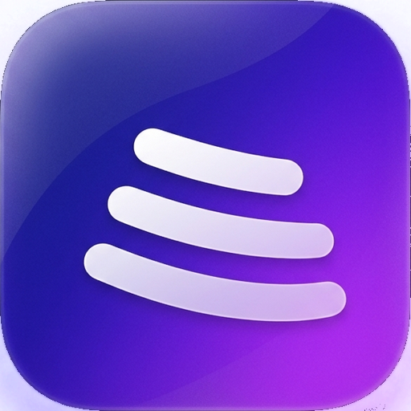
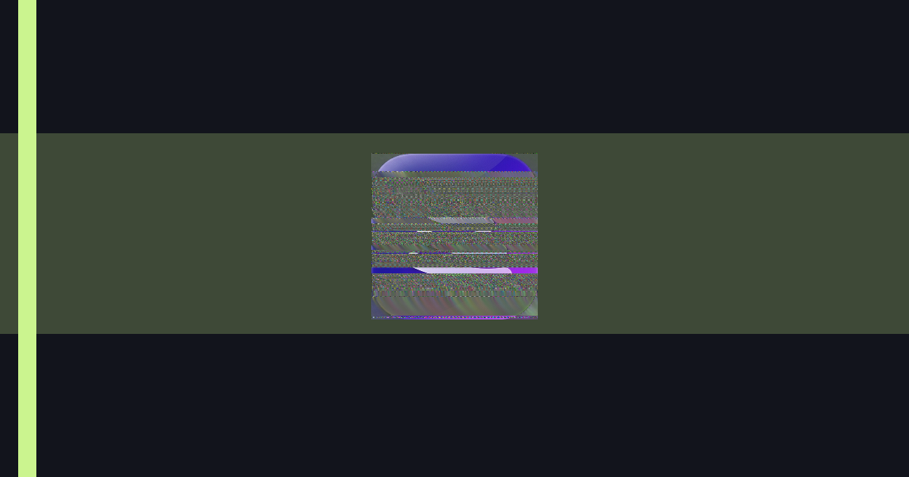

<!--
SYNQ repository README.

This file is intentionally a product README first and a project note second.
The developer-ops notes that used to live here have been preserved below the
product section for anyone working on the code itself.
-->

<div align="center">

  { width="180" }

  # SYNQ

  ### Your music, uninterrupted.

  [](https://github.com/raisulkhan23/synqmusic/releases)
  [](LICENSE.txt)
  [](https://github.com/raisulkhan23/synqmusic/releases)

  [Website](https://synqmusic.freebuff.app) · [Features](#features) · [Screenshots](#screenshots) · [Download](#download) · [Installation](#installation) · [Releases](#releases) · [Contributing](#contributing)

</div>

SYNQ is a modern music player focused on discovery, smooth playback, and a cleaner listening experience. It is designed to get out of the way: search and recommendations up front, a persistent player that behaves like a player should, and a queue that moves the way a listener does.

- Browse and search without signing in.
- Sign in when you want to play, save, or sync.
- Crossfade and gapless playback when the track supports it.
- A fullscreen player, a smart queue, and a living listening history.
- A PWA you can install, a Windows desktop build, and an Android app.

> SYNQ is an independent project. It streams music from third-party public sources at your request and does not host, cache, or redistribute any music catalog. You remain responsible for the terms of service of any source or account you connect to it.



## Features

SYNQ is built around listening first. The details below reflect what the app is trying to be, not every piece of infrastructure behind it.

| What you get | What it means |
| --- | --- |
| **Persistent player** | A player that stays put while you browse, search, and move around the app. |
| **Smart queue** | Add tracks, reorder them, and let the app continue when the queue runs out. |
| **Play Next** | Cut to the next track you actually want instead of waiting on the current one. |
| **Crossfade & gapless** | Tracks blend into one another where supported, with no dead air between songs by default. |
| **Music-first search** | Search that is built for music, with artist and track discovery front and center. |
| **Recommendations** | Personalized suggestions based on what you listen to. |
| **Recently played & continue listening** | Easy picks for when you want to pick up where you left off. |
| **Liked songs** | A simple place to keep the tracks you return to. |
| **Playlists** | Your own playlists, saved and synced to your account. |
| **Listening history** | A record of what you have played, available when you are signed in. |
| **Fullscreen player** | A dedicated fullscreen view for focused listening. |
| **Lyrics** | Lyrics support where available. |
| **Visualizer** | A live visualizer in the player. |
| **Theme presets** | Visual themes and dynamic artwork colors for the surfaces you already look at. |
| **Responsive interface** | Built to work on both desktop and mobile. |
| **Desktop app** | A Windows desktop build that runs the same app outside the browser. |
| **Android app** | An Android app for installed listening on mobile. |
| **Installable app (PWA)** | Install the web app to a device and use it offline when the shell is available. |
| **Deferred sign-in** | Browse first and sign in when you do something that needs an account. |
| **Account control** | Sign in, sign out, and switch accounts from the places you already use. |

### Audio

- Crossfade lengths of `0 / 2 / 4 / 6 / 8 / 10` seconds, configured in **Settings → Audio**.
- Equal-power fade curve, so the blend stays steady through the transition.
- Gapless playback on by default.
- Preloading for the incoming track before it is needed.
- Two-deck audio architecture, so one track can overlap the next where the browser and source allow it.

### Library

- Liked songs.
- Playlists you create and name yourself.
- Playlist import from other music services where supported.
- Listening history for signed-in accounts.

### Discovery

- Home, discover, search, and artist pages that prioritize music over clutter.
- Recommendations driven by listening signals.
- Recently played and continue listening for easy returns.

### Experience

- Fullscreen player.
- Lyrics panel where supported.
- Live visualizer.
- Theme presets and dynamic artwork colors.
- Installable as a PWA.
- Windows desktop build and Android app.

### Authenticated experience

- Account sync for settings and player preferences.
- Authorized downloads where the service allows them.
- Listening history and recommendations tied to your account.

### Honest limitations

- Gapless is **not sample-accurate**. A small scheduler-level seam can remain.
- The YouTube IFrame cannot be crossfaded through Web Audio. When a track is forced onto the IFrame, transitions fall back to gapless rather than pretending to blend.
- Some YouTube videos cannot be played through the embed path and depend on direct-stream resolution succeeding.
- The install flow requires a published build because service workers in front of a dev server can cache module URLs that are rehashed on every dependency re-optimization.

## Screenshots

A few representative views of SYNQ.

| | |
| --- | --- |
|  | The main SYNQ experience. |

If you want more screenshots here, add real captures of the app under `assets/readme/screenshots/` and reference them from this section. Preferred shots:

- Home and discovery
- Search
- Library and playlists
- Mini player
- Fullscreen player
- Lyrics or visualizer
- Settings and personalization
- Windows desktop app
- Android app

> This section currently uses the project banner and logo assets as stand-ins. Replace them with app screenshots when you have them.

## Download

<div align="center">

  ## Download SYNQ

  
  
  

  [Android APK](https://github.com/raisulkhan23/synqmusic/releases)
  [`SYNQ-1.0.0-x64.exe`](https://github.com/raisulkhan23/synqmusic/releases)
  [`SYNQ-1.0.0-x64-Portable.exe`](https://github.com/raisulkhan23/synqmusic/releases)

  Latest version: **1.0.0**

  Built packages exist for Windows and Android. Published release downloads are posted on the [releases page](https://github.com/raisulkhan23/synqmusic/releases) once they are published.

  [View all releases](https://github.com/raisulkhan23/synqmusic/releases)

</div>

SYNQ ships as a website you can install, a Windows desktop app, and an Android app. The exact download to use depends on what you want to run.

| Platform | What to use |
| --- | --- |
| Web | [https://synqmusic.freebuff.app](https://synqmusic.freebuff.app) |
| Installable app | Install the PWA from the website when available. |
| Windows | Desktop installer or portable build. |
| Android | Android APK. |

### Download buttons

| Android | Windows | Windows |
| --- | --- | --- |
|  |  |  |
| [APK](https://github.com/raisulkhan23/synqmusic/releases) | [Installer](https://github.com/raisulkhan23/synqmusic/releases) | [Portable](https://github.com/raisulkhan23/synqmusic/releases) |

Links go to the releases page because published assets are posted there. If a build for your platform is not yet published, the releases page is the place to watch.

## Installation

### Web

1. Open [https://synqmusic.freebuff.app](https://synqmusic.freebuff.app).
2. Browse, search, and play.
3. Install as a PWA from the browser or from the in-app install strip when prompted.

Installing as a PWA gives you a standalone app experience with home-screen shortcuts and offline caching where supported.

### Windows

1. Download the Windows installer or portable build from the [releases page](https://github.com/raisulkhan23/synqmusic/releases).
2. Run the installer and follow the prompts, or extract the portable build and run `SYNQ.exe` directly.
3. Launch SYNQ and sign in when you are ready to save or sync.

The Windows build is an Electron app that runs the same SYNQ interface outside the browser. SmartScreen or other OS warnings may appear for an unpublished or unsigned build; this is expected for a project build and does not mean the app is unsafe.

### Android

1. Download `SYNQ-1.0.0-release.apk` from the [releases page](https://github.com/raisulkhan23/synqmusic/releases) when it is published.
2. Install the APK outside an app store.
3. Allow installation from this source when your device asks.

Minimum supported Android version is determined by the app build configuration in `android/app/build.gradle`. If you install an APK built outside the release signing setup, it may be unsigned and not installable.

### Account

You can browse a lot of SYNQ before signing in. Sign in when you want to:

- Play tracks that need an account.
- Save likes and playlists.
- Sync settings and preferences.
- Use history and recommendations tied to your account.

### Troubleshooting

- If a track will not play, try a different source or wait a moment and retry.
- Some YouTube videos cannot be played through the embed path and depend on direct-stream resolution.
- If the app looks broken after an install, make sure you are running a published build, not a dev-server build.

## Releases

SYNQ follows [Keep a Changelog](https://keepachangelog.com/en/1.1.0/) and semantic versioning.

| | |
| --- | --- |
| **Current release in the repo:** | **1.0.0** |
| **Releases page:** | [https://github.com/raisulkhan23/synqmusic/releases](https://github.com/raisulkhan23/synqmusic/releases) |
| **Changelog:** | [CHANGELOG.md](CHANGELOG.md) |

### Release artifacts

When a release is published, it should include:

- Windows installer
- Windows portable build
- Android APK

Built packages exist in the repository for Windows and Android. Published release artifacts are posted on the releases page when available.

### Verifying a build

For the Windows installer, the build metadata in `desktop-dist/latest.yml` includes a SHA-512 for the installer. Use that to verify the file you downloaded is the one the build produced.

The following SHA-256 values are for the built copies currently in the repository. If a file changes, these values change too.

| Artifact | SHA-256 |
| --- | --- |
| `SYNQ-1.0.0-x64.exe` | `7382149212fed6c69961b154bc055210d50c3e7c9c16d7b8d11171df5e9bcf94` |
| `SYNQ-1.0.0-x64-Portable.exe` | `13123067d37b954d6f5f72977ec5a36d7ddea13e78ee447fbc35c2bd9b626a23` |
| `SYNQ-1.0.0-release.apk` | `5813d9e382379e4a7d918cd3798f20d83368abf1b75be9601469b86d382c1771` |

## Contributing

If you want to work on SYNQ:

- [Open an issue](https://github.com/raisulkhan23/synqmusic/issues) for bugs and feature ideas.
- [Open a pull request](https://github.com/raisulkhan23/synqmusic/pulls) for changes.
- Read [CHANGELOG.md](CHANGELOG.md) before proposing a change, so you know what the project is already tracking.

If you are new here, the project conventions live in the source tree and in the project docs. Start from the code and the changelog, not from assumptions about what the app should do.

## Support

- Use [GitHub Issues](https://github.com/raisulkhan23/synqmusic/issues) for bugs and suggestions.
- Use [GitHub Discussions](https://github.com/raisulkhan23/synqmusic/discussions) if the repository has them enabled.

Do not message the maintainer through unofficial channels unless they have said they are available there.

## License

SYNQ is released under the terms in [LICENSE.txt](LICENSE.txt).

> This repository currently includes a license file, but the repository license metadata has not been confirmed on GitHub. If you are viewing this on GitHub and the license badge or license metadata looks wrong, check `LICENSE.txt` directly.

## Project notice

SYNQ is an independent music player project.

- It streams music from third-party public sources at your request.
- It does not host, cache, or redistribute any music catalog.
- You remain responsible for the terms of service of any source or account you connect to it.

No third party is endorsing SYNQ by virtue of it being able to play content from their services.

---

## Developer notes

> These notes are for people working on the code. They are preserved from the
> previous project README and are not part of the product-facing section above.

### Tech stack

- Vite
- TypeScript
- React Router v7, importing from `react-router` rather than `react-router-dom`
- React 19 for frontend components
- Tailwind v4 for styling
- Shadcn UI for UI components
- Lucide Icons
- Convex for backend and database
- Convex Auth for authentication
- Framer Motion for animations
- Three.js for 3D graphics

All relevant source files live in `src/`.

Use `bun` for the package manager.

### Setup

The project is already configured to run in its cloud environment and against a Convex development sandbox.

### Environment variables

The client uses project-specific `CONVEX_DEPLOYMENT` and `VITE_CONVEX_URL` values.

The Convex server uses its own environment variables, including auth-specific keys such as `JWKS`, `JWT_PRIVATE_KEY`, and `SITE_URL`.

### Android release signing

The release APK and the Play bundle are signed with a key that lives outside this repository. `android/app/build.gradle` reads `android/keystore.properties` when it exists; when it does not, a release build still completes but produces an unsigned, uninstallable APK and says so:

```
SYNQ: android/keystore.properties is missing, so this release build will be UNSIGNED ...
```

One-time setup:

```bash
npm run android:keystore          # creates android/<name>.jks + keystore.properties
```

or do it by hand, following `android/keystore.properties.example`. Both files are gitignored (`android/.gitignore` and the root `.gitignore`), and both should be backed up somewhere that is not this working copy. Losing the key means the app can never be updated on Google Play again, and committing it means anyone can publish as you.

Then build as usual:

```bash
npm run android:release   # APK  → android/app/build/outputs/apk/release/app-release.apk
npm run android:aab       # AAB  → android/app/build/outputs/bundle/release/app-release.aab
```

Verify what you got:

```bash
cd android && ./gradlew :app:signingReport
```

The `release` variant must show your own keystore and alias. If it says `Config: null`, the properties file is missing or was not picked up.

### Authentication

Convex authentication is already set up.

- The email OTP configuration is defined in `src/convex/auth/emailOtp.ts`. **Do not modify this file.**
- Do not modify `src/convex/auth.config.ts` or `src/convex/auth.ts`.

Use the `useAuth` hook to get user data:

```typescript
import { useAuth } from "@/hooks/use-auth";

const { isLoading, isAuthenticated, user, signIn, signOut } = useAuth();
```

Protected routes should redirect signed-out users to `/auth?returnTo=<current route>`. The default post-auth redirect is `/dashboard`; update it when the product’s main authenticated route is different.

### Frontend conventions

- Pages go in `src/pages`.
- Components go in `src/components`.
- Shadcn primitives live in `src/components/ui` and should be used by default.
- Make apps mobile responsive.
- Avoid nested cards and avoid shadows unless there is a clear reason for them.

Use `cursor-pointer` on clickable elements.
Use `tracking-tight font-bold` for title text.

### Animation

Use Framer Motion to animate components. Fade in/out, slide in/out, and interactive UI feedback are all expected.

### Theming

Override colors in `src/index.css`. The project uses the `oklch` color format for Tailwind v4.

Use the project’s theme variable names. Set themes using `dark` or `light` classes on a parent element.

### Toasts

Use Sonner for toasts:

```typescript
import { toast } from "sonner";
```

### Convex backend

The Convex schema lives in `src/convex/schema.ts`.

Use `_id` and `_creationTime` as provided by Convex. Do not index `_creationTime` yourself.

External connections belong in Convex actions that use `"use node"`. Use the existing internal query and mutation helpers where they already exist.
The `/auth` route in `src/main.tsx` redirects to `/dashboard` by default. If the
product's main authenticated route is different, update `redirectAfterAuth` to
that route. A validated same-origin `returnTo` query parameter takes priority so
users can resume the protected page they originally requested. Never leave an
authenticated product redirecting back to the public landing page.

## Complete authenticated products

When the requested product implies accounts, a workspace, a dashboard, or other
signed-in functionality, the task is not complete with only a landing page and
auth form. Build the main authenticated experience, protect its route, and verify
that signing in reaches it.

# Frontend Conventions

You will be using the Vite frontend with React 19, Tailwind v4, and Shadcn UI.

Generally, pages should be in the `src/pages` folder, and components should be in the `src/components` folder.

Shadcn primitives are located in the `src/components/ui` folder and should be used by default.

## Page routing

Your page component should go under the `src/pages` folder.

When adding a page, update the react router configuration in `src/main.tsx` to include the new route you just added.

## Shad CN conventions

Follow these conventions when using Shad CN components, which you should use by default.
- Remember to use "cursor-pointer" to make the element clickable
- For title text, use the "tracking-tight font-bold" class to make the text more readable
- Always make apps MOBILE RESPONSIVE. This is important
- AVOID NESTED CARDS. Try and not to nest cards, borders, components, etc. Nested cards add clutter and make the app look messy.
- AVOID SHADOWS. Avoid adding any shadows to components. stick with a thin border without the shadow.
- Avoid skeletons; instead, use the loader2 component to show a spinning loading state when loading data.


## Landing Pages

You must always create good-looking designer-level styles to your application. 
- Make it well animated and fit a certain "theme", ie neo brutalist, retro, neumorphism, glass morphism, etc

Use known images and emojis from online.

If the user is logged in already, show the get started button to say "Dashboard" or "Profile" instead to take them there.

## Responsiveness and formatting

Make sure pages are wrapped in a container to prevent the width stretching out on wide screens. Always make sure they are centered aligned and not off-center.

Always make sure that your designs are mobile responsive. Verify the formatting to ensure it has correct max and min widths as well as mobile responsiveness.

- Always create sidebars for protected dashboard pages and navigate between pages
- Always create navbars for landing pages
- On these bars, the created logo should be clickable and redirect to the index page

## Animating with Framer Motion

You must add animations to components using Framer Motion. It is already installed and configured in the project.

To use it, import the `motion` component from `framer-motion` and use it to wrap the component you want to animate.


### Other Items to animate
- Fade in and Fade Out
- Slide in and Slide Out animations
- Rendering animations
- Button clicks and UI elements

Animate for all components, including on landing page and app pages.

## Three JS Graphics

Your app comes with three js by default. You can use it to create 3D graphics for landing pages, games, etc.


## Colors

You can override colors in: `src/index.css`

This uses the oklch color format for tailwind v4.

Always use these color variable names.

Make sure all ui components are set up to be mobile responsive and compatible with both light and dark mode.

Set theme using `dark` or `light` variables at the parent className.

## Styling and Theming

When changing the theme, always change the underlying theme of the shad cn components app-wide under `src/components/ui` and the colors in the index.css file.

Avoid hardcoding in colors unless necessary for a use case, and properly implement themes through the underlying shad cn ui components.

When styling, ensure buttons and clickable items have pointer-click on them (don't by default).

Always follow a set theme style and ensure it is tuned to the user's liking.

## Toasts

You should always use toasts to display results to the user, such as confirmations, results, errors, etc.

Use the shad cn Sonner component as the toaster. For example:

```
import { toast } from "sonner"

import { Button } from "@/components/ui/button"
export function SonnerDemo() {
  return (
    <Button
      variant="outline"
      onClick={() =>
        toast("Event has been created", {
          description: "Sunday, December 03, 2023 at 9:00 AM",
          action: {
            label: "Undo",
            onClick: () => console.log("Undo"),
          },
        })
      }
    >
      Show Toast
    </Button>
  )
}
```

Remember to import { toast } from "sonner". Usage: `toast("Event has been created.")`

## Dialogs

Always ensure your larger dialogs have a scroll in its content to ensure that its content fits the screen size. Make sure that the content is not cut off from the screen.

Ideally, instead of using a new page, use a Dialog instead. 

# Using the Convex backend

You will be implementing the convex backend. Follow your knowledge of convex and the documentation to implement the backend.

## The Convex Schema

You must correctly follow the convex schema implementation.

The schema is defined in `src/convex/schema.ts`.

Do not include the `_id` and `_creationTime` fields in your queries (it is included by default for each table).
Do not index `_creationTime` as it is indexed for you. Never have duplicate indexes.


## Convex Actions: Using CRUD operations

When running anything that involves external connections, you must use a convex action with "use node" at the top of the file.

You cannot have queries or mutations in the same file as a "use node" action file. Thus, you must use pre-built queries and mutations in other files.

You can also use the pre-installed internal crud functions for the database:

```ts
// in convex/users.ts
import { crud } from "convex-helpers/server/crud";
import schema from "./schema.ts";

export const { create, read, update, destroy } = crud(schema, "users");

// in some file, in an action:
const user = await ctx.runQuery(internal.users.read, { id: userId });

await ctx.runMutation(internal.users.update, {
  id: userId,
  patch: {
    status: "inactive",
  },
});
```


## Common Convex Mistakes To Avoid

When using convex, make sure:
- Document IDs are referenced as `_id` field, not `id`.
- Document ID types are referenced as `Id<"TableName">`, not `string`.
- Document object types are referenced as `Doc<"TableName">`.
- Keep schemaValidation to false in the schema file.
- You must correctly type your code so that it passes the type checker.
- You must handle null / undefined cases of your convex queries for both frontend and backend, or else it will throw an error that your data could be null or undefined.
- Always use the `@/folder` path, with `@/convex/folder/file.ts` syntax for importing convex files.
- This includes importing generated files like `@/convex/_generated/server`, `@/convex/_generated/api`
- Remember to import functions like useQuery, useMutation, useAction, etc. from `convex/react`
- NEVER have return type validators.
